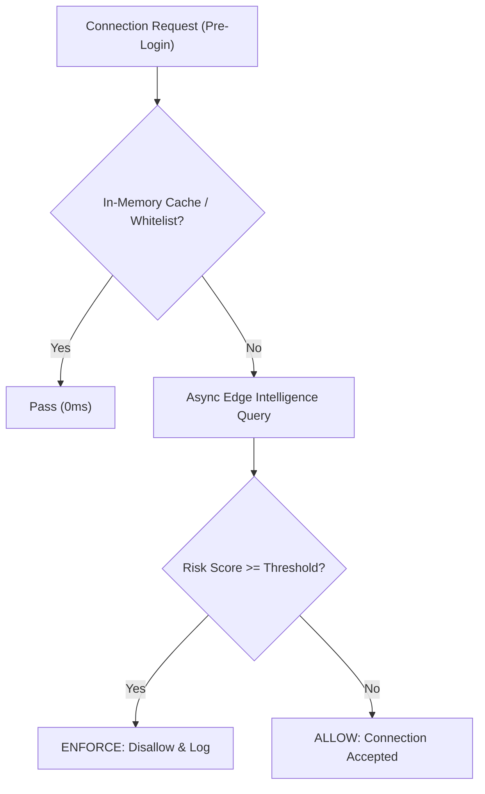

# Sentinel Minecraft Connector

<p align="center">
  <a href="https://github.com/antivpn-tech/sentinel-mc/releases"></a>
  <a href="https://kotlinlang.org"></a>
  <a href="https://papermc.io"></a>
  <a href="https://antivpn.tech"></a>
  <a href="https://opensource.org/licenses/MIT"></a>
</p>

Sentinel Minecraft Connector is the official universal Kotlin connector linking Minecraft servers and proxy networks directly to the Sentinel Edge Intelligence Network ([antivpn.tech](https://antivpn.tech)).

It provides low-latency proxy and VPN detection, and routing preservation for gaming optimizers (Cloudflare WARP, ExitLag, WTFast, etc.). Delivered as a single universal JAR for Velocity, BungeeCord, Waterfall, Folia, Paper, Purpur, Spigot, and Bukkit.

---

## Key Capabilities

- **Universal Drop-in Binary**: Single artifact automatically initializes on Velocity 3.3+, BungeeCord, Waterfall, Folia, and Paper / Purpur / Spigot 1.8 through 1.21+.
- **Fail-Open Architecture**: Asynchronous non-blocking HTTP/2 queries. If the edge network or remote API is unreachable, queries resolve to `ALLOW` to prevent blocking legitimate players.
- **Gaming Optimizer & WARP Bypass**: Preserves competitive players utilizing latency routing services and privacy proxies (Cloudflare WARP, ExitLag, WTFast, NoPing, Mudfish, GearUP, LagoFast) without false positive kicks.
- **Batched Discord Telemetry**: Rate-limit-aware webhook dispatcher consolidates attack waves into structured digest embeds, preventing HTTP 429 webhook drops during floods.
- **In-Memory Cache**: High-throughput memory cache eliminates redundant API queries during player reconnects or proxy server switches.
- **Local Lists**: Administrative `/sentinel` commands for in-game IP and username whitelisting and blacklisting.

---

## Detection Workflow



---

## Authentication and Licenses

To connect to the Sentinel intelligence network:

1. Create an account at [antivpn.tech](https://antivpn.tech).
2. Generate an API license key from the dashboard (Developer, Starter, or Enterprise).
3. Insert your license key (`stl_live_...`) into `plugins/Sentinel/config.yml`.

---

## Installation

1. Download `Sentinel-Minecraft-1.0.0.jar` from the [Releases](https://github.com/antivpn-tech/sentinel-mc/releases) page.
2. Place the JAR into your server's `plugins/` directory:
   - Velocity: `/plugins/Sentinel-Minecraft-1.0.0.jar`
   - BungeeCord / Waterfall: `/plugins/Sentinel-Minecraft-1.0.0.jar`
   - Paper / Purpur / Spigot: `/plugins/Sentinel-Minecraft-1.0.0.jar`
3. Start the server to generate default configurations.
4. Configure your license key in `plugins/Sentinel/config.yml` (or `plugins/sentinel/config.yml` on Velocity).
5. Execute `/sentinel reload` to apply settings.

---

## Configuration Reference

```yaml
# ==============================================================================
#                 Sentinel Anti-VPN Protection Configuration
#                        https://antivpn.tech
# ==============================================================================

api:
  # Sentinel Edge Intelligence API endpoint
  endpoint: "https://api.antivpn.tech/v1/check"

  # Your Sentinel License Key (Claim your free Developer key at https://antivpn.tech)
  license-key: "stl_live_your_api_key_here"

  # HTTP connection timeout in milliseconds
  timeout-ms: 2500

# ------------------------------------------------------------------------------
# Protection Mode:
# ENFORCE - Active Blocking Mode (Default). Disallows proxy/VPN connections.
# AUDIT   - Passive Monitoring Mode. Logs detections without kicking players.
# ------------------------------------------------------------------------------
mode: "ENFORCE"

# Risk threshold (0 - 100). Commercial VPNs and proxies rate 85-100.
risk-threshold: 80

# Whitelist gaming VPNs and ping optimizers (Cloudflare WARP, ExitLag, WTFast, NoPing, Mudfish, GearUP, LagoFast)
allow-gaming-optimizers: true

# Graduated Defense Policy (Recommended: true)
# Immediately kicks deterministic threats while protecting mobile/CGNAT pools
graduated-defense: true

# In-memory IP cache duration in minutes
cache-duration-minutes: 30

# ------------------------------------------------------------------------------
# Discord Webhook Telemetry
# ------------------------------------------------------------------------------
discord:
  enabled: true
  webhook-url: ""
  notify-only-on-threat: true
  server-name: "Minecraft Network"

# ------------------------------------------------------------------------------
# Enforcement Disconnect Screen
# Line 1 is reserved and permanently branded with: &9&lSentinel Protection (Blue)
# Configure your custom server description and appeal details below (\n or /n)
# Placeholders: %player%, %ip%, %threat%, %risk%
# ------------------------------------------------------------------------------
enforcement:
  # [Line 1: Reserved by Sentinel Protection]
  kick-message: "&7VPN / Proxy traffic is restricted on this server.\n&8Threat: &f%threat% &7| &8Risk: &f%risk%/100\n&7Join our Discord (&fhttps://discord.gg/yourlink&7) to request VPN access."
```

---

## Commands and Permissions

Administrative commands require the `sentinel.admin` permission (granted to server operators by default).

| Command | Description |
| :--- | :--- |
| `/sentinel status` | Displays active protection mode, cache volume, list counts, and webhook state. |
| `/sentinel reload` | Reloads `config.yml`, `whitelist.json`, and `blacklist.json`. |
| `/sentinel check <ip\|player>` | Queries live intelligence for an online player or target IP address. |
| `/sentinel whitelist list` | Lists all whitelisted usernames and IP addresses. |
| `/sentinel whitelist add <player\|ip>` | Adds a target to the whitelist (bypasses all checks). |
| `/sentinel whitelist remove <player\|ip>` | Removes a target from the whitelist. |
| `/sentinel blacklist list` | Lists all blacklisted usernames and IP addresses. |
| `/sentinel blacklist add <player\|ip>` | Adds a target to the blacklist (immediate rejection). |
| `/sentinel blacklist remove <player\|ip>` | Removes a target from the blacklist. |

---

## Building from Source

Requirements:
- JDK 17 or higher
- Apache Maven 3.8 or higher

```bash
git clone https://github.com/antivpn-tech/sentinel-mc.git
cd sentinel-mc
mvn clean package
```

The compiled universal JAR will be produced at `target/Sentinel-Minecraft-1.0.0.jar`.

---

## License

This project is licensed under the [MIT License](LICENSE).
